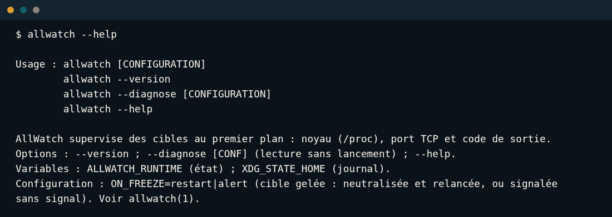

# AllWatch

[](https://allwatch.davalan.fr/download/)
[](LICENSE)
[](https://allwatch.davalan.fr/download/)

[English](README.md) | [Français](docs/fr-FR/README.md) | [Deutsch](docs/de-DE/README.md) | [Español](docs/es-ES/README.md) | [中文](docs/zh-CN/README.md)



AllWatch is a tiny process supervisor for Linux, written in a single Bash
script (about one hundred and fifty useful lines of code). It starts each target in the
foreground, remembers its PID, and judges its health only from what the kernel
and the network say: is the process still in `/proc`, does its TCP port still
accept a connection, and what exit code did it leave. It restarts the target
according to a per-target policy and refuses to loop forever on a target that
dies at once.

The target is a black box. It does not register with AllWatch, does not send
it anything and does not need to know it exists.

## Install on Debian and Ubuntu

The Debian package installs the supervisor as `/usr/bin/allwatch`, the
`allwatch.service` systemd unit, the example configuration and the manual page
in five languages. Download the package and `SHA256SUMS` from the
[download page](https://allwatch.davalan.fr/download/), then run:

```bash
sudo apt install ./allwatch_0.1.0-6_all.deb
```

Level announced: **installation and diagnosis validated in a container**, on
Debian 12 and 13 and on Ubuntu 22.04 and 24.04. The package is not presented
as tested on a physical server. The service is installed enabled, with a
configuration that declares no target; add your targets to
`/etc/allwatch/allwatch.conf`, then run `sudo systemctl restart allwatch`.

Check the installed version and the configuration without starting a target:

```bash
allwatch --version
allwatch --help
allwatch --diagnose /etc/allwatch/allwatch.conf
```

`--diagnose` reads the configuration, the state directory and the log path. It
does not start or probe a target, so it does not prove that a target is
healthy; it proves that the supervisor can read its configuration and use its
paths.

To remove the package:

```bash
sudo apt remove allwatch
sudo apt purge allwatch
```

`apt remove` stops the service but leaves it enabled; `apt purge` also removes
the configuration and the service state.

## Run from the source repository

Requirements: Linux (the supervisor reads `/proc`), Bash 5 or later, and
`timeout` and `awk` from the usual core utilities. For the test double
`dummy-target.sh` only: `setpriv` (util-linux) and OpenBSD `nc`.

```bash
git clone https://github.com/RonanDavalan/AllWatch.git
cd AllWatch
./allwatch.sh --version
./allwatch.sh --help
./allwatch.sh allwatch.conf
```

The example configuration launches `dummy-target.sh` on port 9001 under the id
`demo`. In a second terminal, look at the target:

```bash
cat /tmp/allwatch-runtime/demo.pid
: > /dev/tcp/127.0.0.1/9001 && echo "port 9001 answers"
```

Kill the target the hard way and see it come back with a new PID (the poll
interval is 5 seconds):

```bash
kill -9 "$(cat /tmp/allwatch-runtime/demo.pid)"
sleep 6
cat /tmp/allwatch-runtime/demo.pid
```

Make the target hang (it stays alive but closes its port). AllWatch notices,
stops it and restarts it, which takes about fifteen seconds:

```bash
kill -USR1 "$(cat /tmp/allwatch-runtime/demo.pid)"
sleep 20
grep ' demo ' ~/.local/state/allwatch/allwatch.log | tail -n 6
```

Stop the supervisor with `Ctrl+C` (or `SIGTERM`); it stops its targets and
empties its state directory:

```bash
ls -A /tmp/allwatch-runtime
```

## How it works

AllWatch is the parent, the target is the child. Every few seconds it looks at
each target and puts it in one of four states:

- **Up**: the process exists and its port accepts a connection.
- **Hung**: the process exists but its port does not answer. With
  `ON_FREEZE=restart` (the default), AllWatch sends `SIGTERM`, waits for the
  target to stop (5 seconds), sends `SIGKILL` if needed, then treats the
  target as failed. With `ON_FREEZE=alert`, it sends no signal, logs
  `ALERTE GEL` once, keeps the target under watch and logs `RETABLI` when the
  port answers again.
- **Crashed**: the process is gone without a deliberate stop. AllWatch reads
  the exit code and restarts the target if its policy says so.
- **Quit**: the target ended and its policy says to leave it alone, or the
  restart limit was reached.

## Configuration

The configuration is read once, at startup, line by line. Empty lines and
lines starting with `#` are ignored. Engine parameters, one `KEY=value` per
line:

- `POLL_SECONDS=5`: seconds between two checks.
- `PROBE_TIMEOUT=3`: seconds a port has to answer the probe.
- `MAX_RESTARTS=5`: restarts allowed inside the window below.
- `RESTART_WINDOW=60`: length of that window, in seconds.
- `ON_FREEZE=restart`: a hung target is neutralized and restarted; `alert`
  leaves it untouched and logs `ALERTE GEL`. Any other value is refused at
  startup with exit code 1.

Targets, one per line:

```text
id port policy command...
```

- `id`: a short name, used for the state files and the log.
- `port`: the TCP port the target listens on (probed on `127.0.0.1`).
- `policy`: one of `always`, `on-failure`, `transient`.
- `command...`: the rest of the line, split on spaces (no quoting), run in the
  foreground from the directory where `allwatch.sh` was started.

Policies:

- `always`: restart the target whenever it ends, even with exit code 0, unless
  a file `<id>.stop` exists in the state directory.
- `on-failure`: restart it after a crash or a hang, but leave it stopped after
  an exit code 0.
- `transient`: never restart it.

If a target reaches `MAX_RESTARTS` restarts within `RESTART_WINDOW`
seconds, AllWatch stops restarting it, logs `ALERTE VERROU_CRITIQUE` and
carries on with the other targets.

The state directory is `/tmp/allwatch-runtime` (override with
`ALLWATCH_RUNTIME`); the log is a flat file, one line per event
(`date id event`), in
`${XDG_STATE_HOME:-$HOME/.local/state}/allwatch/allwatch.log`.

## The contract a target must respect

AllWatch adapts to nothing; a target that breaks the contract is the one at
fault.

- **Foreground.** The target runs in the foreground of the process AllWatch
  starts. It must not daemonize or double-fork: AllWatch would see the first
  process end and start a duplicate.
- **Exit codes.** A clean, requested stop exits with code `0`. Any failure
  exits with a non-zero code.
- **A TCP port.** Each target owns one TCP port, open and accepting
  connections as soon as it is initialised. A target that is alive but does
  not accept a connection within the probe timeout is considered hung.
- **`SIGTERM`.** The target catches `SIGTERM`, releases its resources and
  exits with code `0` within 5 seconds. After that, AllWatch sends `SIGKILL`.

The window title, the display server and the target's own output play no part
in the health check.

## Limits

- No hot reload of the configuration: `sudo systemctl restart allwatch`.
- No check based on window titles, X11 or Wayland.
- No parsing of application logs to decide a restart.
- No supervision of a target that daemonizes or double-forks.
- `--diagnose` is static: it reads the configuration and the paths, it does
  not probe a target and it does not prove that a target is healthy.
- `--version`, `--help` and `--diagnose` are recognised only as the first
  argument.
- The command is not run through a shell: no quoting, pipes, redirections or
  variable expansion.
- Numeric configuration values and policy names are not validated. A
  non-numeric `POLL_SECONDS` stops the supervisor with exit `1`; a mistyped
  policy acts as `always`. `ON_FREEZE` is validated: an unknown value stops
  the supervisor with exit `1`.
- The flat log is not rotated.

## License

MIT. See `LICENSE`.

## Credits

- **Ronan Davalan**: architect and arbiter. He set the vision and the scope,
  arbitrated the specifications and validated them.
- **Claude Sonnet 5.5** (Anthropic): sole author of the code (the supervisor
  and the test double), written in three coding sessions on 13 November 2026.
- **Gemini** (Google): strategic synthesis and co-writing of the
  specifications: detection of anti-patterns, formalisation of the four-state
  machine.

See `CONTRIBUTORS.md`.
