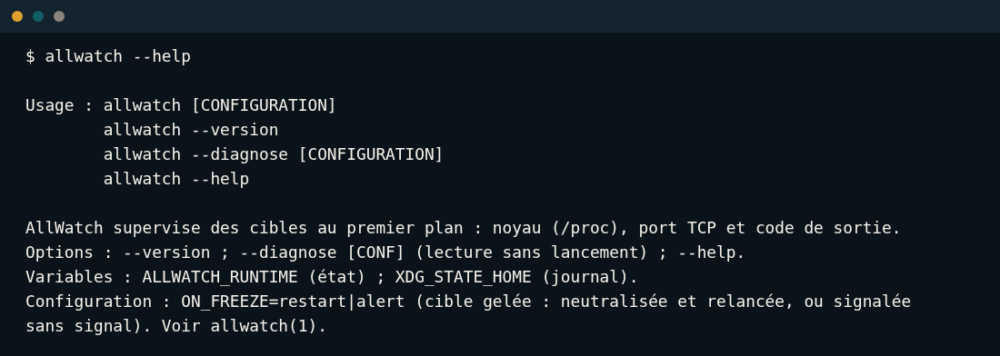

# AllWatch

[](https://allwatch.davalan.fr/de/download/)
[](../../LICENSE)
[](https://allwatch.davalan.fr/de/download/)

[English](../../README.md) | [Français](../fr-FR/README.md) | [Deutsch](README.md) | [Español](../es-ES/README.md) | [中文](../zh-CN/README.md)



AllWatch ist ein winziger Prozess-Supervisor für Linux, geschrieben in einem
einzigen Bash-Skript (etwa hundertfünfzig nutzbare Zeilen). Er startet jedes Ziel im
Vordergrund, merkt sich dessen PID und beurteilt seine Gesundheit nur anhand
von Kernel und Netzwerk: Existiert der Prozess noch in `/proc`, nimmt sein
TCP-Port noch Verbindungen an, und welchen Exit-Code hat er hinterlassen? Er
startet das Ziel gemäß einer Richtlinie pro Ziel neu und gerät nicht in eine
Endlosschleife bei einem Ziel, das sofort stirbt.

Das Ziel ist eine Blackbox. Es registriert sich nicht bei AllWatch, sendet
ihm nichts und muss nicht wissen, dass AllWatch existiert.

## Installation auf Debian und Ubuntu

Das Debian-Paket installiert den Supervisor als `/usr/bin/allwatch`, die
systemd-Unit `allwatch.service`, die Beispielkonfiguration und die
Handbuchseite in fünf Sprachen. Laden Sie das Paket und `SHA256SUMS` von der
[Download-Seite](https://allwatch.davalan.fr/de/download/) herunter und
führen Sie aus:

```bash
sudo apt install ./allwatch_0.1.0-4_all.deb
```

Angekündigte Stufe: **Installation und Diagnose im Container validiert**, auf
Debian 12 und 13 sowie auf Ubuntu 22.04 und 24.04. Das Paket wird nicht als
auf einem physischen Server getestet bezeichnet. Der Dienst wird aktiviert
installiert, mit einer Konfiguration ohne Ziel; tragen Sie Ihre Ziele in
`/etc/allwatch/allwatch.conf` ein und führen Sie dann
`sudo systemctl restart allwatch` aus.

Prüfen Sie die installierte Version und die Konfiguration, ohne ein Ziel zu
starten:

```bash
allwatch --version
allwatch --help
allwatch --diagnose /etc/allwatch/allwatch.conf
```

`--diagnose` liest die Konfiguration, das Zustandsverzeichnis und den
Journalpfad. Es startet und prüft kein Ziel; es beweist nicht, dass ein Ziel
gesund ist, sondern dass der Supervisor seine Konfiguration lesen und seine
Pfade nutzen kann.

Zum Entfernen:

```bash
sudo apt remove allwatch
sudo apt purge allwatch
```

`apt remove` stoppt den Dienst, lässt ihn aber aktiviert; `apt purge`
entfernt zusätzlich die Konfiguration und den Dienstzustand.

## Aus dem Quelltext starten

Voraussetzungen: Linux (der Supervisor liest `/proc`), Bash 5 oder neuer
sowie `timeout` und `awk` aus den üblichen Coreutils. Nur für das Testziel
`dummy-target.sh`: `setpriv` (util-linux) und OpenBSD `nc`.

```bash
git clone https://github.com/RonanDavalan/AllWatch.git
cd AllWatch
./allwatch.sh --version
./allwatch.sh --help
./allwatch.sh allwatch.conf
```

Die Beispielkonfiguration startet `dummy-target.sh` auf Port 9001 unter der
Kennung `demo`. In einem zweiten Terminal:

```bash
cat /tmp/allwatch-runtime/demo.pid
: > /dev/tcp/127.0.0.1/9001 && echo "Port 9001 antwortet"
```

Töten Sie das Ziel hart und beobachten Sie, wie es mit einer neuen PID
zurückkommt (Abfrageintervall 5 Sekunden):

```bash
kill -9 "$(cat /tmp/allwatch-runtime/demo.pid)"
sleep 6
cat /tmp/allwatch-runtime/demo.pid
```

Lösen Sie einen Hänger aus (das Ziel bleibt am Leben, schließt aber seinen
Port). AllWatch erkennt es, stoppt und startet es neu, was etwa fünfzehn
Sekunden dauert:

```bash
kill -USR1 "$(cat /tmp/allwatch-runtime/demo.pid)"
sleep 20
grep ' demo ' ~/.local/state/allwatch/allwatch.log | tail -n 6
```

Beenden Sie den Supervisor mit `Ctrl+C` (oder `SIGTERM`); er stoppt seine
Ziele und leert sein Zustandsverzeichnis:

```bash
ls -A /tmp/allwatch-runtime
```

## Arbeitsweise

AllWatch ist der Elternprozess, das Ziel ist das Kind. Alle paar Sekunden
prüft er jedes Ziel und ordnet es einem von vier Zuständen zu:

- **Läuft**: Der Prozess existiert und sein Port nimmt eine Verbindung an.
- **Hängt**: Der Prozess existiert, aber sein Port antwortet nicht. Mit
  `ON_FREEZE=restart` (Standard) sendet AllWatch `SIGTERM`, wartet 5 Sekunden,
  sendet bei Bedarf `SIGKILL` und behandelt das Ziel danach als fehlgeschlagen.
  Mit `ON_FREEZE=alert` sendet es kein Signal, schreibt einmal `ALERTE GEL`,
  lässt das Ziel überwacht und schreibt `RETABLI`, wenn der Port wieder
  antwortet.
- **Abgestürzt**: Der Prozess ist ohne geordnetes Ende verschwunden. AllWatch
  liest den Exit-Code und startet das Ziel gemäß seiner Richtlinie neu.
- **Beendet**: Das Ziel ist beendet und seine Richtlinie verlangt keinen
  Neustart, oder das Neustartlimit wurde erreicht.

## Konfiguration

Die Konfiguration wird beim Start einmal zeilenweise gelesen. Leere Zeilen
und Zeilen, die mit `#` beginnen, werden ignoriert. Motorenparameter, ein
`KEY=value` pro Zeile:

- `POLL_SECONDS=5`: Sekunden zwischen zwei Prüfungen.
- `PROBE_TIMEOUT=3`: Sekunden, die ein Port für die Probe hat.
- `MAX_RESTARTS=5`: erlaubte Neustarts im folgenden Fenster.
- `RESTART_WINDOW=60`: Länge dieses Fensters in Sekunden.
- `ON_FREEZE=restart`: Ein hängendes Ziel wird neutralisiert und neu gestartet; `alert` lässt es unberührt und schreibt `ALERTE GEL`. Jeder andere Wert wird beim Start mit Exit-Code 1 zurückgewiesen.

Ziele, eines pro Zeile:

```text
id port policy command...
```

- `id`: ein kurzer Name für Zustandsdateien und Journal.
- `port`: der TCP-Port des Ziels (geprüft auf `127.0.0.1`).
- `policy`: `always`, `on-failure` oder `transient`.
- `command...`: der Rest der Zeile, an Leerzeichen getrennt (ohne
  Anführungszeichen), im Vordergrund aus dem Startverzeichnis ausgeführt.

Richtlinien:

- `always`: das Ziel nach jedem Ende neu starten, auch nach Exit-Code 0,
  außer eine Datei `<id>.stop` liegt im Zustandsverzeichnis.
- `on-failure`: nach Absturz oder Hänger neu starten, nach Exit-Code 0
  beendet lassen.
- `transient`: niemals neu starten.

Braucht ein Ziel `MAX_RESTARTS` Neustarts innerhalb von
`RESTART_WINDOW` Sekunden, stellt AllWatch die Neustarts ein, schreibt
`ALERTE VERROU_CRITIQUE` und führt die anderen Ziele weiter.

Das Zustandsverzeichnis ist `/tmp/allwatch-runtime` (überschreibbar mit
`ALLWATCH_RUNTIME`); das Journal ist eine flache Datei, eine Zeile pro
Ereignis (`date id event`), unter
`${XDG_STATE_HOME:-$HOME/.local/state}/allwatch/allwatch.log`.

## Vertrag eines Ziels

AllWatch passt sich an nichts an; ein Ziel, das den Vertrag bricht, ist im
Fehler.

- **Vordergrund.** Das Ziel läuft im Vordergrund des von AllWatch gestarteten
  Prozesses. Es darf nicht dämonisieren oder doppelt forken.
- **Exit-Codes.** Ein sauberer, angeforderter Stopp endet mit Code `0`. Jeder
  Fehler endet mit einem Code ungleich null.
- **Ein TCP-Port.** Jedes Ziel besitzt einen TCP-Port, offen und
  verbindungsbereit ab seiner Initialisierung. Ein lebendes Ziel, das im
  Probe-Zeitfenster keine Verbindung annimmt, gilt als hängend.
- **`SIGTERM`.** Das Ziel fängt `SIGTERM`, gibt seine Ressourcen frei und
  endet innerhalb von 5 Sekunden mit Code `0`. Danach sendet AllWatch
  `SIGKILL`.

Fenstertitel, Anzeigeserver und die eigene Ausgabe des Ziels spielen für die
Gesundheitsprüfung keine Rolle.

## Grenzen

- Kein Hot-Reload der Konfiguration: `sudo systemctl restart allwatch`.
- Keine Prüfung über Fenstertitel, X11 oder Wayland.
- Keine Analyse von Anwendungsjournalen für Neustartentscheidungen.
- Keine Überwachung von Zielen, die sich im Hintergrund ablösen.
- `--diagnose` ist statisch: Es liest Konfiguration und Pfade, prüft kein
  Ziel und beweist nicht, dass ein Ziel gesund ist.
- `--version`, `--help` und `--diagnose` werden nur als erstes Argument
  erkannt.
- Der Befehl läuft nicht durch eine Shell: keine Anführungszeichen, Pipes,
  Umleitungen oder Variablenexpansion.
- Konfigurationswerte und Richtliniennamen werden nicht validiert.
- Das flache Journal wird nicht rotiert.

## Lizenz

MIT. Siehe `LICENSE`.

## Danksagung

- **Ronan Davalan**: Architekt und Schiedsrichter. Er setzte Vision und
  Umfang, entschied über die Spezifikationen und validierte sie.
- **Claude Sonnet 5.5** (Anthropic): alleiniger Autor des Codes (Supervisor
  und Testziel), geschrieben in drei Sitzungen am 13. November 2026.
- **Gemini** (Google): strategische Synthese und Mitverfassung der
  Spezifikationen.

Siehe `CONTRIBUTORS.md`.
