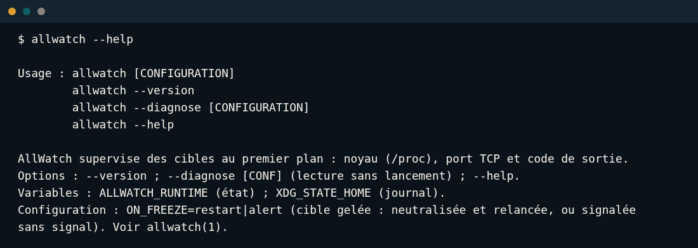

# AllWatch

[](https://allwatch.davalan.fr/fr/telechargement/)
[](../../LICENSE)
[](https://allwatch.davalan.fr/fr/telechargement/)

[English](../../README.md) | [Français](README.md) | [Deutsch](../de-DE/README.md) | [Español](../es-ES/README.md) | [中文](../zh-CN/README.md)



AllWatch est un micro-superviseur de processus pour Linux, écrit dans un seul
script Bash (environ cent cinquante lignes utiles de code). Il lance chaque
cible au premier plan, mémorise son PID et juge sa santé uniquement à partir de
ce que disent le noyau et le réseau : le processus est-il toujours dans
`/proc`, son port TCP accepte-t-il encore une connexion, et quel code de sortie
a-t-il laissé. Il redémarre la cible selon une politique propre à chaque cible
et refuse de boucler indéfiniment sur une cible qui meurt aussitôt.

La cible est une boîte noire. Elle ne s'enregistre pas auprès d'AllWatch, ne lui
envoie rien et n'a pas besoin de savoir qu'il existe.

## Installer sur Debian et Ubuntu

Le paquet Debian installe le superviseur sous `/usr/bin/allwatch`, l'unité
systemd `allwatch.service`, la configuration d'exemple et la page de manuel en
cinq langues. Téléchargez le paquet et `SHA256SUMS` depuis la [page de
téléchargement](https://allwatch.davalan.fr/fr/telechargement/), puis lancez :

```bash
sudo apt install ./allwatch_0.1.0-7_all.deb
```

Niveau annoncé : **installation et diagnostic validés en conteneur**, sur
Debian 12 et 13 et sur Ubuntu 22.04 et 24.04. Le paquet n'est pas présenté
comme testé sur un serveur physique. Le service est installé et activé, avec
une configuration qui ne déclare aucune cible ; ajoutez vos cibles dans
`/etc/allwatch/allwatch.conf`, puis lancez `sudo systemctl restart allwatch`.

Vérifiez la version installée et la configuration sans lancer de cible :

```bash
allwatch --version
allwatch --help
allwatch --diagnose /etc/allwatch/allwatch.conf
```

`--diagnose` lit la configuration, le répertoire d'état et le chemin du
journal. Il ne lance ni ne sonde aucune cible : il ne prouve pas qu'une cible
est saine, il prouve que le superviseur peut lire sa configuration et utiliser
ses chemins.

Pour retirer le paquet :

```bash
sudo apt remove allwatch
sudo apt purge allwatch
```

`apt remove` arrête le service mais le laisse activé ; `apt purge` retire aussi
la configuration et l'état du service.

## Installer sur Fedora, openSUSE Leap et Arch Linux

Le même tag construit aussi des paquets natifs : un `.rpm` pour Fedora, un `.rpm` pour openSUSE Leap et un `.pkg.tar.zst` pour Arch Linux. Téléchargez le fichier de votre famille et `SHA256SUMS` depuis la [page de téléchargement](https://allwatch.davalan.fr/fr/telechargement/), puis lancez la ligne de votre famille (Fedora, openSUSE Leap, Arch Linux, dans cet ordre) :

```bash
sudo dnf install ./allwatch-0.1.0-1.fc44.noarch.rpm
sudo zypper install --allow-unsigned-rpm ./allwatch-0.1.0-1.leap160.noarch.rpm
sudo pacman -U ./allwatch-0.1.0-1-any.pkg.tar.zst
```

Niveau annoncé : **installation et diagnostic validés en conteneur**, sur Fedora 43, 44 et 45, sur openSUSE Leap 16.0 et sur Arch Linux. Les paquets ne sont pas présentés comme testés sur un serveur physique. Le service est installé mais pas démarré : ajoutez vos cibles à `/etc/allwatch/allwatch.conf`, puis lancez `sudo systemctl enable --now allwatch`. Les commandes `allwatch --version`, `--help` et `--diagnose` sont celles montrées plus haut.

Pour retirer le paquet :

```bash
sudo dnf remove allwatch
sudo zypper remove allwatch
sudo pacman -R allwatch
```

Le retrait garde l'utilisateur système `allwatch` et `/var/lib/allwatch`, ainsi que votre configuration si vous l'avez modifiée (sauvegardée en `allwatch.conf.rpmsave` ou `allwatch.conf.pacsave`). Pour les effacer aussi :

```bash
sudo userdel allwatch
sudo rm -rf /etc/allwatch /var/lib/allwatch
```

## Exécution depuis le dépôt de code

Prérequis : Linux (le superviseur lit `/proc`), Bash 5 ou plus récent, et
`timeout` et `awk` parmi les utilitaires de base habituels. Pour le double de
test `dummy-target.sh` seulement : `setpriv` (util-linux) et OpenBSD `nc`.

```bash
git clone https://github.com/RonanDavalan/AllWatch.git
cd AllWatch
./allwatch.sh --version
./allwatch.sh --help
./allwatch.sh allwatch.conf
```

La configuration d'exemple lance `dummy-target.sh` sur le port 9001 sous
l'identifiant `demo`. Dans un second terminal, examinez la cible :

```bash
cat /tmp/allwatch-runtime/demo.pid
: > /dev/tcp/127.0.0.1/9001 && echo "le port 9001 répond"
```

Éliminez la cible de manière radicale et observez-la revenir avec un nouveau PID
(l'intervalle d'interrogation est de 5 secondes) :

```bash
kill -9 "$(cat /tmp/allwatch-runtime/demo.pid)"
sleep 6
cat /tmp/allwatch-runtime/demo.pid
```

Provoquez le blocage de la cible (elle reste active mais ferme son port).
AllWatch le détecte, l'arrête et la redémarre, ce qui prend environ quinze
secondes :

```bash
kill -USR1 "$(cat /tmp/allwatch-runtime/demo.pid)"
sleep 20
grep ' demo ' ~/.local/state/allwatch/allwatch.log | tail -n 6
```

Arrêtez le superviseur avec `Ctrl+C` (ou `SIGTERM`) ; il arrête ses cibles et
vide son répertoire d'état :

```bash
ls -A /tmp/allwatch-runtime
```

## Comment ça marche

AllWatch est le parent, la cible est l'enfant. Toutes les quelques secondes, il
examine chaque cible et la place dans l'un des quatre états suivants :

- **En cours** : le processus existe et son port accepte une connexion.
- **Bloqué** : le processus existe mais son port ne répond pas. Avec
  `ON_FREEZE=restart` (le défaut), AllWatch envoie `SIGTERM`, attend l'arrêt de
  la cible (5 secondes), envoie `SIGKILL` si nécessaire, puis considère la cible
  comme défaillante. Avec `ON_FREEZE=alert`, il n'envoie aucun signal,
  journalise `ALERTE GEL` une fois, laisse la cible surveillée et journalise
  `RETABLI` quand le port répond de nouveau.
- **Plantage** : le processus a disparu sans arrêt délibéré. AllWatch lit le
  code de sortie et redémarre la cible si sa politique le demande.
- **Quitter** : la cible a terminé et sa politique demande de la laisser
  arrêtée, ou la limite de redémarrage a été atteinte.

## Configuration

La configuration est lue une seule fois, au démarrage, ligne par ligne. Les
lignes vides et les lignes commençant par `#` sont ignorées. Paramètres du
moteur, une ligne `KEY=value` chacun :

- `POLL_SECONDS=5` : secondes entre deux vérifications.
- `PROBE_TIMEOUT=3` : secondes dont dispose un port pour répondre à la sonde.
- `MAX_RESTARTS=5` : redémarrages autorisés dans la fenêtre ci-dessous.
- `RESTART_WINDOW=60` : durée de cette fenêtre, en secondes.
- `ON_FREEZE=restart` : une cible bloquée est neutralisée et relancée ; `alert`
  la laisse intacte et journalise `ALERTE GEL`. Toute autre valeur est refusée
  au démarrage avec le code 1.

Cibles, une par ligne :

```text
id port policy command...
```

- `id` : un nom court, utilisé pour les fichiers d'état et le journal.
- `port` : le port TCP sur lequel la cible écoute (sondé sur `127.0.0.1`).
- `policy` : l'une des valeurs `always`, `on-failure`, `transient`.
- `command...` : le reste de la ligne, séparé par des espaces (sans guillemets),
  exécuté au premier plan depuis le répertoire où `allwatch.sh` a été lancé.

Politiques :

- `always` : redémarrer la cible chaque fois qu'elle se termine, même avec le
  code de sortie 0, sauf si un fichier `<id>.stop` existe dans le répertoire
  d'état.
- `on-failure` : redémarrer après un plantage ou un blocage, mais laisser
  arrêtée après un code de sortie 0.
- `transient` : ne jamais la redémarrer.

Si une cible atteint `MAX_RESTARTS` redémarrages dans les `RESTART_WINDOW`
secondes, AllWatch cesse de la redémarrer, enregistre `ALERTE VERROU_CRITIQUE`
et continue avec les autres cibles.

Le répertoire d'état est `/tmp/allwatch-runtime` (à remplacer avec
`ALLWATCH_RUNTIME`) ; le journal est un fichier plat, une ligne par événement
(`date id event`), dans `${XDG_STATE_HOME:-$HOME/.local/state}/allwatch/allwatch.log`.

## Le contrat qu'une cible doit respecter

AllWatch ne s'adapte à rien ; la cible qui rompt le contrat est en faute.

- **Premier plan.** La cible s'exécute au premier plan du processus lancé par
  AllWatch. Elle ne doit pas se transformer en processus démon ni créer de
  double processus : AllWatch verrait alors le premier processus se terminer et
  en lancerait un duplicata.
- **Codes de sortie.** Un arrêt propre et demandé se termine par le code `0`.
  Toute erreur se termine par un code différent de zéro.
- **Un port TCP.** Chaque cible possède un port TCP, ouvert et acceptant les
  connexions dès son initialisation. Une cible active qui n'accepte pas de
  connexion dans le délai de la sonde est considérée comme bloquée.
- **`SIGTERM`.** La cible intercepte `SIGTERM`, libère ses ressources et se
  termine avec le code `0` en moins de 5 secondes. Ensuite, AllWatch envoie
  `SIGKILL`.

Le titre de la fenêtre, le serveur d'affichage et la sortie propre à la cible ne
jouent aucun rôle dans le contrôle d'intégrité.

## Limites

- Aucun rechargement à chaud de la configuration : `sudo systemctl restart
  allwatch`.
- Aucune vérification fondée sur les titres de fenêtre, X11 ou Wayland.
- Aucune analyse des journaux d'application pour décider d'un redémarrage.
- Aucune surveillance d'une cible qui se transforme en démon ou fait un double
  fork.
- `--diagnose` est statique : il lit la configuration et les chemins, il ne
  sonde aucune cible et ne prouve pas qu'une cible est saine.
- `--version`, `--help` et `--diagnose` ne sont reconnus qu'en première position.
- La commande n'est pas exécutée par un shell : ni guillemets, ni tubes, ni
  redirections, ni expansion de variables.
- Les valeurs numériques de configuration et les noms de politique ne sont pas
  validés. Un `POLL_SECONDS` non numérique arrête le superviseur avec le code
  `1` ; une politique mal orthographiée agit comme `always`. `ON_FREEZE` est
  validé : une valeur inconnue arrête le superviseur avec le code `1`.
- Le journal plat n'est pas rotaté.

## Licence

MIT. Voir `LICENSE`.

## Crédits

- **Ronan Davalan** : architecte et arbitre. Il a défini la vision et le
  périmètre, arbitré les spécifications et les a validées.
- **Claude Sonnet 5.5** (Anthropic) : seul auteur du code (le superviseur et le
  double de test), écrit en trois sessions de codage le 13 novembre 2026.
- **Gemini** (Google) : synthèse stratégique et co-écriture des spécifications :
  détection des anti-modèles, formalisation de la machine à quatre états.

Voir `CONTRIBUTORS.md`.
