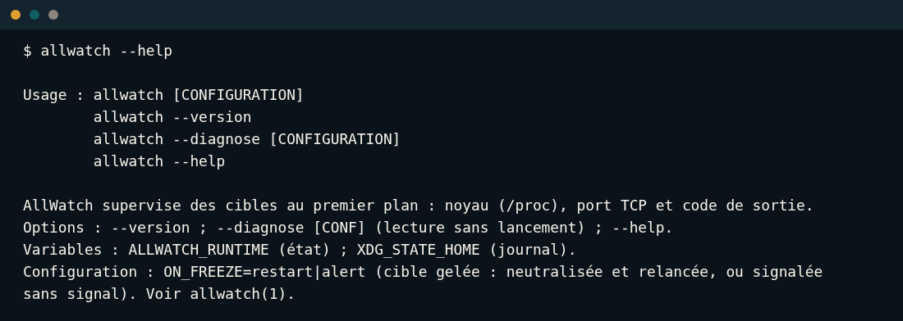

# AllWatch

[](https://allwatch.davalan.fr/zh/download/)
[](../../LICENSE)
[](https://allwatch.davalan.fr/zh/download/)

[English](../../README.md) | [Français](../fr-FR/README.md) | [Deutsch](../de-DE/README.md) | [Español](../es-ES/README.md) | [中文](README.md)



AllWatch 是面向 Linux 的微型进程监控器，由一个 Bash 脚本写成（约一百五十行有效代码）。
它让每个目标进程在前台启动，记住其 PID，只依据内核和网络给出的事实判断其健康：
进程是否仍在 `/proc` 中，其 TCP 端口是否仍接受连接，以及它结束时留下什么退出码。
它按每个目标进程的策略重启目标，并拒绝在一个刚启动就死亡的进程上无限循环。

目标进程是一个黑盒。它不向 AllWatch 注册，不向它发送任何内容，也不需要知道它的存在。

## 在 Debian 和 Ubuntu 上安装

Debian 软件包把监控器安装为 `/usr/bin/allwatch`，同时安装 `allwatch.service`
systemd 单元、示例配置和五种语言的手册页。请从[下载页面](https://allwatch.davalan.fr/zh/download/)
取得软件包和 `SHA256SUMS`，然后运行：

```bash
sudo apt install ./allwatch_0.1.0-7_all.deb
```

公布的验证级别：**安装与诊断已在容器中验证**，覆盖 Debian 12 和 13，以及 Ubuntu 22.04 和 24.04。
软件包不宣称已在物理服务器上测试。服务安装后处于启用状态，配置不声明任何目标进程；
请把目标加入 `/etc/allwatch/allwatch.conf`，然后运行 `sudo systemctl restart allwatch`。

在不启动目标进程的情况下检查已安装的版本和配置：

```bash
allwatch --version
allwatch --help
allwatch --diagnose /etc/allwatch/allwatch.conf
```

`--diagnose` 读取配置、状态目录和日志路径。它不启动也不探测目标进程，
因此不能证明某个目标进程健康；它证明监控器能够读取配置并使用其路径。

要移除软件包：

```bash
sudo apt remove allwatch
sudo apt purge allwatch
```

`apt remove` 停止服务但保留其启用状态；`apt purge` 还会移除配置和服务状态。

## 在 Fedora、openSUSE Leap 和 Arch Linux 上安装

同一个标签还会构建原生软件包：Fedora 的 `.rpm`、openSUSE Leap 的 `.rpm` 和 Arch Linux 的 `.pkg.tar.zst`。从[下载页面](https://allwatch.davalan.fr/zh/download/)下载您所用发行版系列的文件和 `SHA256SUMS`，然后运行对应的命令行（依次为 Fedora、openSUSE Leap、Arch Linux）：

```bash
sudo dnf install ./allwatch-0.1.0-1.fc44.noarch.rpm
sudo zypper install --allow-unsigned-rpm ./allwatch-0.1.0-1.leap160.noarch.rpm
sudo pacman -U ./allwatch-0.1.0-1-any.pkg.tar.zst
```

公布的验证级别：**安装和诊断已在容器中验证**，涵盖 Fedora 43、44 和 45、openSUSE Leap 16.0 以及 Arch Linux。这些软件包不作为已在物理服务器上测试过的软件包来介绍。服务已安装但未启动：请先把您的目标添加到 `/etc/allwatch/allwatch.conf`，再运行 `sudo systemctl enable --now allwatch`。`allwatch --version`、`--help` 和 `--diagnose` 与上文所示相同。

移除软件包：

```bash
sudo dnf remove allwatch
sudo zypper remove allwatch
sudo pacman -R allwatch
```

移除后会保留系统用户 `allwatch` 和 `/var/lib/allwatch`，以及您修改过的配置（保存为 `allwatch.conf.rpmsave` 或 `allwatch.conf.pacsave`）。若要一并清除：

```bash
sudo userdel allwatch
sudo rm -rf /etc/allwatch /var/lib/allwatch
```

## 从源代码仓库运行

要求：Linux（监控器读取 `/proc`）、Bash 5 或更高版本，以及常用核心工具中的
`timeout` 和 `awk`。仅测试替身 `dummy-target.sh` 还需要 `setpriv`（util-linux）
和 OpenBSD `nc`。

```bash
git clone https://github.com/RonanDavalan/AllWatch.git
cd AllWatch
./allwatch.sh --version
./allwatch.sh --help
./allwatch.sh allwatch.conf
```

示例配置以标识 `demo` 在端口 9001 上启动 `dummy-target.sh`。在第二个终端中查看目标进程：

```bash
cat /tmp/allwatch-runtime/demo.pid
: > /dev/tcp/127.0.0.1/9001 && echo "port 9001 answers"
```

强制杀死目标进程，观察它以新的 PID 回来（轮询间隔为 5 秒）：

```bash
kill -9 "$(cat /tmp/allwatch-runtime/demo.pid)"
sleep 6
cat /tmp/allwatch-runtime/demo.pid
```

让目标进程无响应（它仍然存活，但关闭其端口）。AllWatch 会发现、停止并重启它，
大约需要十五秒：

```bash
kill -USR1 "$(cat /tmp/allwatch-runtime/demo.pid)"
sleep 20
grep ' demo ' ~/.local/state/allwatch/allwatch.log | tail -n 6
```

用 `Ctrl+C`（或 `SIGTERM`）停止监控器；它会停止其目标进程并清空状态目录：

```bash
ls -A /tmp/allwatch-runtime
```

## 工作原理

AllWatch 是父进程，目标进程是子进程。它每隔几秒查看每个目标进程，并把它归入四种状态之一：

- **运行中**：进程存在且其端口接受连接。
- **无响应**：进程存在但其端口不响应。使用 `ON_FREEZE=restart`（默认值）时，
  AllWatch 发送 `SIGTERM`，等待目标进程停止（5 秒），必要时发送 `SIGKILL`，
  然后把目标进程视为失败。使用 `ON_FREEZE=alert` 时，它不发送信号，
  只记录一次 `ALERTE GEL`，继续监视目标进程，并在端口重新响应时记录 `RETABLI`。
- **崩溃**：进程在没有主动停止的情况下消失。AllWatch 读取退出码，
  并按目标进程的策略决定是否重启。
- **已退出**：目标进程结束且其策略要求不再处理，或已达到重启上限。

## 配置

配置在启动时逐行读取一次。空行和以 `#` 开头的行会被忽略。
引擎参数，每行一个 `KEY=value`：

- `POLL_SECONDS=5`：两次检查之间的秒数。
- `PROBE_TIMEOUT=3`：端口必须响应探测的秒数。
- `MAX_RESTARTS=5`：在下面窗口内允许的重启次数。
- `RESTART_WINDOW=60`：该窗口的长度，以秒计。
- `ON_FREEZE=restart`：无响应的目标进程会被中和并重启；`alert` 保持目标进程不动，
  并记录 `ALERTE GEL`。其他任何值都会在启动时以退出码 1 拒绝。

目标进程，每行一个：

```text
id port policy command...
```

- `id`：短名称，用于状态文件和日志。
- `port`：目标进程监听的 TCP 端口（在 `127.0.0.1` 上探测）。
- `policy`：`always`、`on-failure`、`transient` 之一。
- `command...`：该行其余部分，按空格拆分（不支持引号），
  从启动 `allwatch.sh` 的目录以前台方式运行。

策略：

- `always`：目标进程每次结束都重启，即使退出码为 0，
  除非状态目录中存在 `<id>.stop` 文件。
- `on-failure`：崩溃或无响应后重启，但在退出码为 0 后保持停止。
- `transient`：从不重启。

如果目标进程在 `RESTART_WINDOW` 秒内达到 `MAX_RESTARTS` 次重启，
AllWatch 就停止重启它，记录 `ALERTE VERROU_CRITIQUE`，并继续处理其他目标进程。

状态目录是 `/tmp/allwatch-runtime`（可用 `ALLWATCH_RUNTIME` 覆盖）；
日志是一个平面文件，每个事件一行（`date id event`），位于
`${XDG_STATE_HOME:-$HOME/.local/state}/allwatch/allwatch.log`。

## 目标进程必须遵守的约定

AllWatch 不做任何迁就；违反约定的目标进程才是过错方。

- **前台。** 目标进程在 AllWatch 启动的进程的前台中运行。
  它不得转为后台守护进程或二次 fork：否则 AllWatch 会看到第一个进程结束，
  然后启动一个重复实例。
- **退出码。** 干净的、被请求的停止以退出码 `0` 结束。任何失败都以非零退出码结束。
- **一个 TCP 端口。** 每个目标进程拥有一个 TCP 端口，在初始化后立即打开并接受连接。
  一个存活但在探测超时内不接受连接的目标进程被视为无响应。
- **`SIGTERM`。** 目标进程捕获 `SIGTERM`，释放其资源，并在 5 秒内以退出码 `0` 结束。
  超过这个时间，AllWatch 发送 `SIGKILL`。

窗口标题、显示服务器和目标进程自身的输出都不参与健康检查。

## 限制

- 配置不支持热重载：`sudo systemctl restart allwatch`。
- 不依据窗口标题、X11 或 Wayland 进行检查。
- 不解析应用程序日志来决定是否重启。
- 不监视转为后台守护进程或二次 fork 的目标进程。
- `--diagnose` 是静态的：它读取配置和路径，不探测目标进程，
  也不能证明某个目标进程健康。
- `--version`、`--help` 和 `--diagnose` 只在第一个参数的位置被识别。
- 命令不经过 shell 运行：不支持引号、管道、重定向或变量展开。
- 数值配置值和策略名称不做校验。非数值的 `POLL_SECONDS` 会让监控器以退出码 `1` 停止；
  拼错的策略按 `always` 处理。`ON_FREEZE` 会校验：未知值会让监控器以退出码 `1` 停止。
- 平面日志不做轮转。

## 许可证

MIT。参见 `LICENSE`。

## 致谢

- **Ronan Davalan**：架构师和仲裁者。他确定愿景和范围，仲裁并验证规范。
- **Claude Sonnet 5.5**（Anthropic）：代码的唯一作者（监控器和测试替身），
  于 2026 年 11 月 13 日在三次编码会话中写成。
- **Gemini**（Google）：战略综合和规范共同撰写：反模式识别、四状态机的形式化。

参见 `CONTRIBUTORS.md`。
